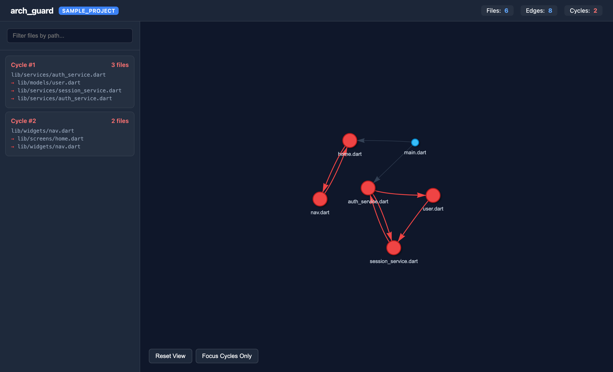
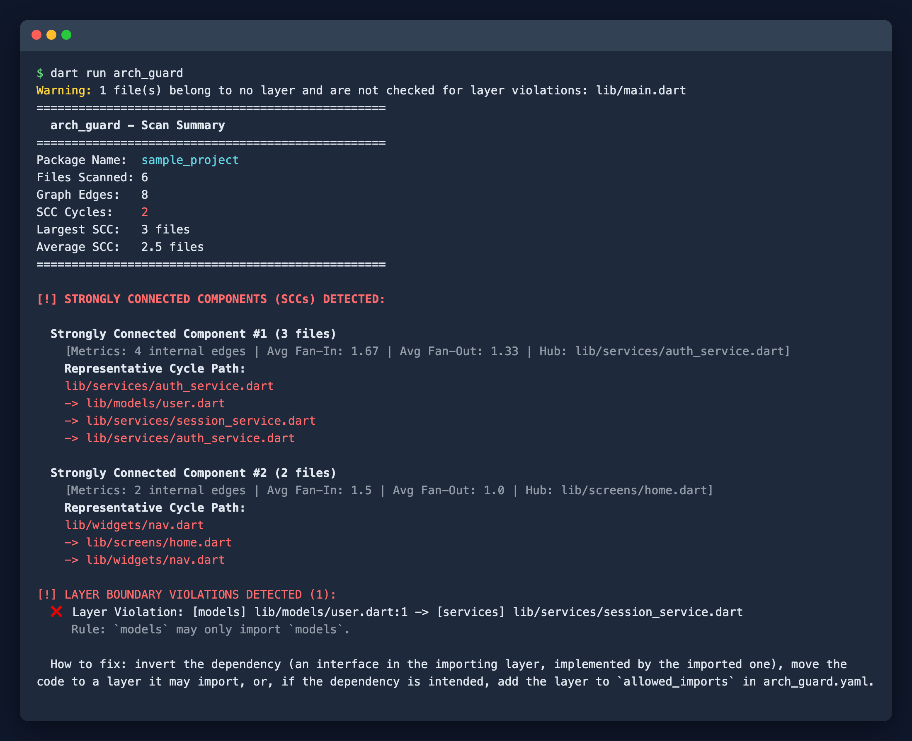

# arch_guard

**Architecture checks for Dart and Flutter.** arch_guard reads every `import`, `export` and `part` directive in your project and fails the build when the code drifts from the architecture you meant.

```bash
dart pub add --dev arch_guard
dart run arch_guard init     # detects your layout and writes arch_guard.yaml
dart run arch_guard          # checks the project; exit code 1 means problems
```

New here? [Getting started](getting-started.md) walks through these three commands and your first report in five minutes.



## What it checks

| Check | Fails when… | Set up in |
| :--- | :--- | :--- |
| Layer rules | `presentation` imports `data`, or any import your layers don't allow | [Presets](presets.md), [`layers:`](configuration.md#how-layers-are-matched) |
| Circular dependencies | files import each other in a loop | on by default |
| Forbidden packages | `domain` imports `flutter`, or any file imports `dart:mirrors` | [`forbidden_packages:`](configuration.md#forbidden-packages) |
| Workspace rules | `packages/core` imports `apps/mobile` in a monorepo | [`workspace_rules:`](configuration.md#workspace-rules) |
| Metric limits | one file imports, or is imported by, too many files | [`metrics:`](configuration.md#metric-limits) |
| Unused files | nothing reaches a file from `main.dart`, tests or other entry points | [`unused_files:`](configuration.md#unused-files) |

Every problem names the file, the line and the rule it breaks, and every cycle names the one import to remove:

```text
❌ Layer Violation: [presentation] lib/features/auth/presentation/page.dart:3 -> [data] lib/features/auth/data/repo.dart
   Rule: `presentation` may only import `core`, `domain`, `presentation`.

Suggested fix: remove lib/screens/home.dart:1 -> lib/widgets/nav.dart (breaks the cycle)
```

## Where it runs

<div class="cards">
  <a href="ci.html"><strong>Pull requests</strong><span>GitHub Action with a PR comment and Code Scanning, GitLab CI, pre-commit hooks.</span></a>
  <a href="testing.html"><strong>Your test suite</strong><span><code>await expectArchitecture();</code> in <code>dart test</code> or <code>flutter test</code>.</span></a>
  <a href="ide.html"><strong>Your editor</strong><span>Warnings on the import line in VS Code and IntelliJ, with quick fixes.</span></a>
  <a href="ai.html"><strong>Your AI agent</strong><span>One prompt sets it up; a skill keeps Claude Code, Codex or Cursor inside the rules.</span></a>
</div>

## Already have a large codebase?

Record today's problems once. From then on only *new* problems fail:

```bash
# writes arch_guard_baseline.json; commit it
dart run arch_guard --update-baseline
```

On pull requests, `--since origin/main` reports only problems in the files the branch changed. See [Adopting on an existing codebase](ci.md#adopting-on-an-existing-codebase-baseline).

## More tools in the box

| Command | What it does |
| :--- | :--- |
| `arch_guard -f html` | Interactive dependency graph you can search and click through. Also Mermaid, DOT, JSON, SARIF, Markdown. |
| `arch_guard why lib/domain flutter` | The import chain that makes one file or folder depend on another, with line numbers. |
| `arch_guard affected --since origin/main` | The test files a branch can affect, so CI runs only those. |
| `arch_guard --watch` | Re-runs the check on every save. |
| `arch_guard --explain <file>` | One file's imports, importers and cycle membership. |

All of them are in the [CLI reference](cli.md).



## Requirements

Dart 3.8 or later (Flutter 3.32 or later). No Dart SDK in CI? Use the [GitHub Action](ci.md#github-action) or a [standalone binary](cli.md#standalone-binaries).

Found a bug or missing a preset? [Open an issue](https://github.com/creatorpiyush/arch_guard/issues).
